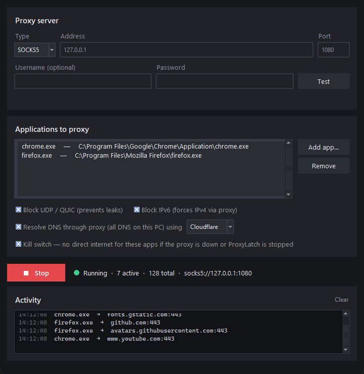

# ProxyLatch

**Send chosen apps through a SOCKS5 or HTTP proxy, on Windows and Linux. The rest of your PC stays untouched.**

Pick a proxy, pick the programs, click Start. Every TCP connection those programs make goes through the proxy, and the programs themselves need no proxy settings. A kill switch keeps them offline whenever the proxy is down or ProxyLatch is stopped.



## Features

- **Per-app proxy**: only the programs you choose use the proxy. Anything they start (helpers, an IDE's language server or terminal) goes through it too.
- **SOCKS5 and HTTP proxies**, with optional username and password. A **Test** button checks the proxy before you start.
- **Kill switch**: no direct connection when the proxy is unreachable, and no internet for the chosen apps while ProxyLatch is stopped.
- **DNS through the proxy** (DNS-over-HTTPS via Cloudflare, Google or Quad9), so your ISP doesn't see your lookups.
- **Domain sniffing**: like v2ray, it reads the domain from each connection (TLS SNI / HTTP `Host`) and gives the proxy the name instead of an IP. Wrong or censored local DNS answers don't matter.
- **Leak protection**: blocks UDP/QUIC and IPv6 for the chosen apps, so browsers fall back to proxied TCP (this also stops WebRTC leaks).
- Works with **Burp Suite** and other intercepting proxies: use them as the HTTP proxy.
- Dark theme, a live activity log, and a single file to run.

## Download

Get the latest program from the [Releases](../../releases) page:

| System | File | Requirements |
|---|---|---|
| Windows 10/11 (64-bit) | `ProxyLatch-windows-x64.exe` | Administrator rights (it asks when you start it) |
| Linux (Ubuntu 22.04+ or similar) | `proxylatch-linux-x64` | `nftables`, `pkexec`, cgroup v2 (see [Linux](#linux)) |

> **Windows warnings:** the program is not code-signed, needs Administrator rights and loads a network driver ([WinDivert](https://github.com/basil00/WinDivert)). SmartScreen or antivirus software may warn about it. Each release lists SHA-256 checksums, and you can always [build it yourself](#building-from-source).

## Usage

1. Enter the proxy type, address and port (plus username and password if needed). Click **Test**.
2. Click **Add app…** and choose one or more programs.
3. Click **Start**. Each connection appears under *Activity* with the program and domain.

Start ProxyLatch before the apps, or restart them after clicking Start. With the kill switch on, connections they opened earlier are reset automatically.

### Options

| Option | What it does |
|---|---|
| Block UDP / QUIC | Blocks the chosen apps' UDP (except DNS). Browsers then use TCP, which goes through the proxy. |
| Block IPv6 | Blocks the chosen apps' IPv6 connections, so they use IPv4 through the proxy. |
| Resolve DNS through proxy | Answers DNS with DNS-over-HTTPS sent through the proxy. **Windows:** affects all DNS on the PC (Windows resolves names for all apps in one shared service). **Linux:** only the chosen apps. |
| Kill switch (on by default) | Running: connections fail instead of going direct when the proxy is down (the status turns red); UDP and IPv6 are always blocked. Stopped or closed: the chosen apps have no internet until you click Start (Windows: firewall rules; Linux: nftables). |

### Linux

ProxyLatch's window runs as you; a small helper runs as root (you're asked for your password once, when you click Start).

- You can add a program, a symlink, a launcher script (e.g. `/usr/bin/google-chrome`, `/usr/bin/cursor`) or a snap (e.g. `/snap/bin/firefox`). Launcher scripts also cover the programs in the app's own folder. The log shows what each entry matches.
- **Use the Launch button for command-line tools** like `curl`: programs started elsewhere are captured a few milliseconds after they start, which is fine for browsers and GUI apps but too late for quick tools. Launch starts the app already inside the proxy.
- Needs cgroup v2 (default since Ubuntu 21.10), a kernel with nftables `socket cgroupv2` support (5.13+), `nftables` and `pkexec`.

## How it works

| | Windows | Linux |
|---|---|---|
| Capture | The WinDivert driver sees each new TCP connection, finds the program that opened it, and redirects the packets of chosen apps to a local relay. | The root helper moves the chosen apps' processes into a cgroup (`proxylatch`); their child processes inherit it. nftables redirects that cgroup's TCP to the relay. |
| Original destination | Remembered from the redirected packets | Read with `SO_ORIGINAL_DST` |
| Privileges | Runs as Administrator | Only the helper runs as root |

The relay (`core.py`) is the same on both systems. It reads the domain from the connection's first bytes, opens the connection through the proxy (SOCKS5 or HTTP CONNECT) and passes data both ways.

| File | Contents |
|---|---|
| `proxylatch.py` | Entry point |
| `core.py` | Config, proxy handshakes, DNS-over-HTTPS, domain sniffing, the relay |
| `gui.py` | The window (tkinter) |
| `backend_windows.py` | Windows capture (WinDivert), firewall kill switch |
| `backend_linux.py`, `linux_helper.py` | Linux capture (nftables + cgroup v2) and the root helper |

## Building from source

Requires Python 3.10 or newer.

**Windows:** run `build.bat`. It installs PyInstaller and pydivert (which provides the WinDivert files) and creates `dist\ProxyLatch.exe`. To run without building: `pip install -r requirements.txt`, then `python proxylatch.py`.

**Linux (Ubuntu/Debian):**
```
./build.sh              # installs missing packages with apt, then builds dist/proxylatch
./build.sh --install    # also installs to /opt/proxylatch, adds a "proxylatch" command and an app menu entry
```
To run without building: `sudo apt install python3-tk nftables pkexec`, then `python3 proxylatch.py`.

**Tests:** `pip install pytest`, then `python -m pytest` (the Windows-only tests are skipped on Linux). GitHub Actions runs them on Windows and Ubuntu for every push. Pushing a tag such as `v1.0.0` builds both programs and publishes a release.

## Limits

- TCP only: UDP is blocked rather than proxied, and IPv6 is blocked rather than proxied.
- If ProxyLatch crashes or the PC loses power while running, the kill switch is back only after you open ProxyLatch again.
- Windows: the stopped-state kill switch covers apps added by full path, not by bare name (e.g. `chrome.exe`), and not their child processes.
- Linux: apps started while ProxyLatch is closed aren't blocked by the kill switch.
- Settings, including the proxy password, are stored in a plain file readable only by your user: `%APPDATA%\ProxyLatch\config.json` (Windows) or `~/.config/ProxyLatch/config.json` (Linux).

## Responsible use

ProxyLatch only changes how your own programs reach the internet. Use it with proxies and networks you're allowed to use. When testing applications (e.g. with Burp Suite), only test systems you're authorized to test.

## License

MIT (see [LICENSE](LICENSE)). The Windows build includes WinDivert (LGPL-3.0); see [THIRD_PARTY_NOTICES.md](THIRD_PARTY_NOTICES.md).
